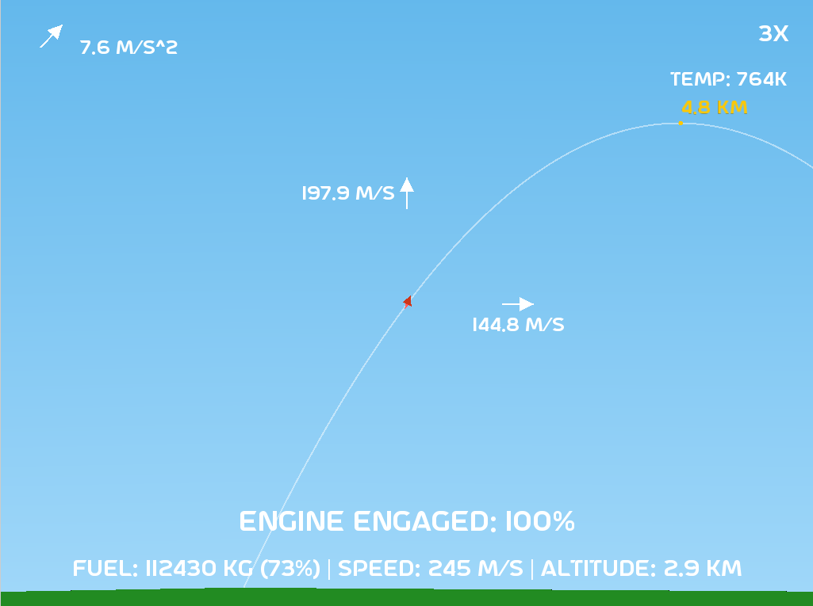
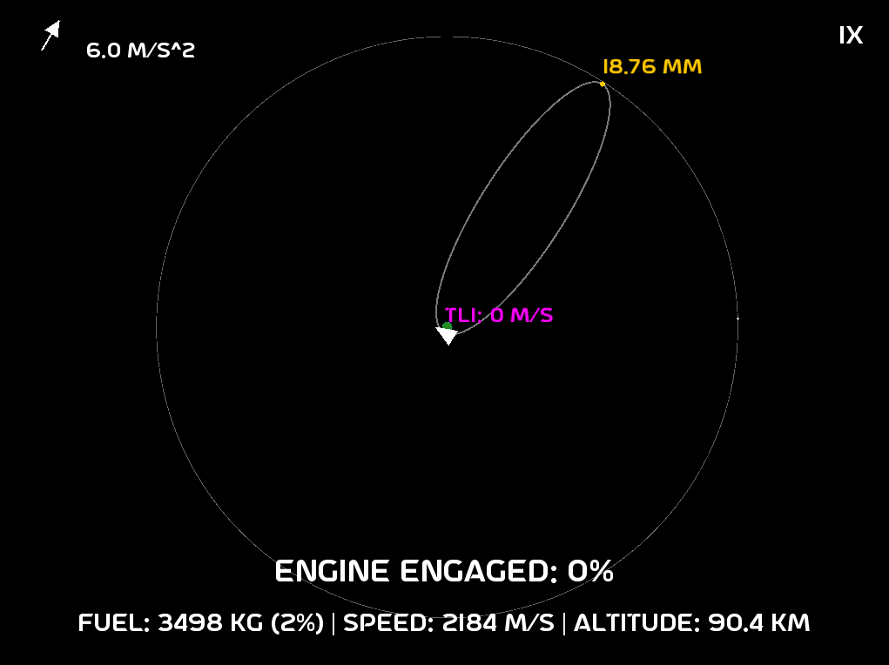
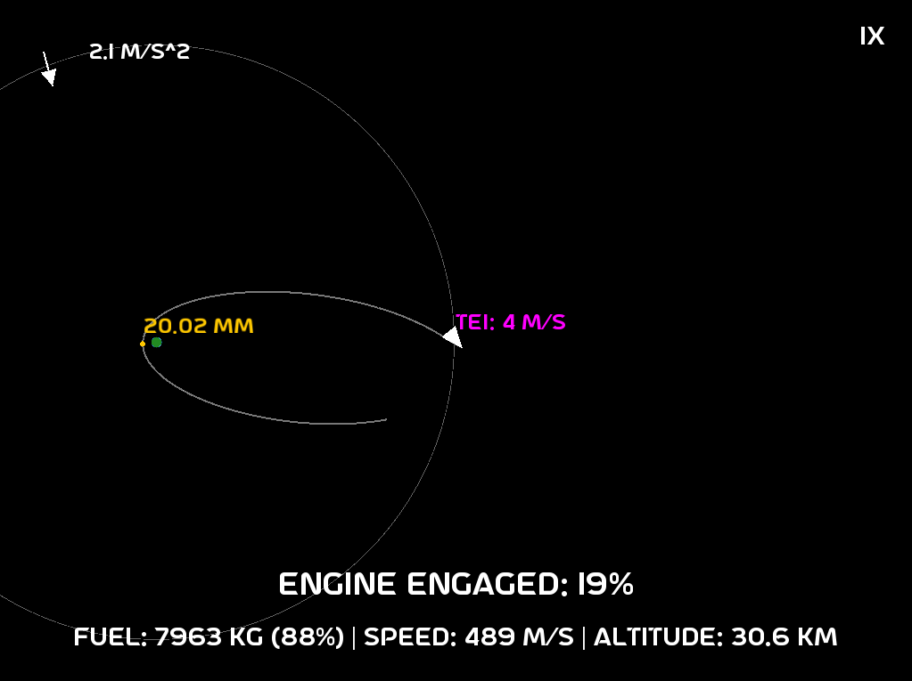
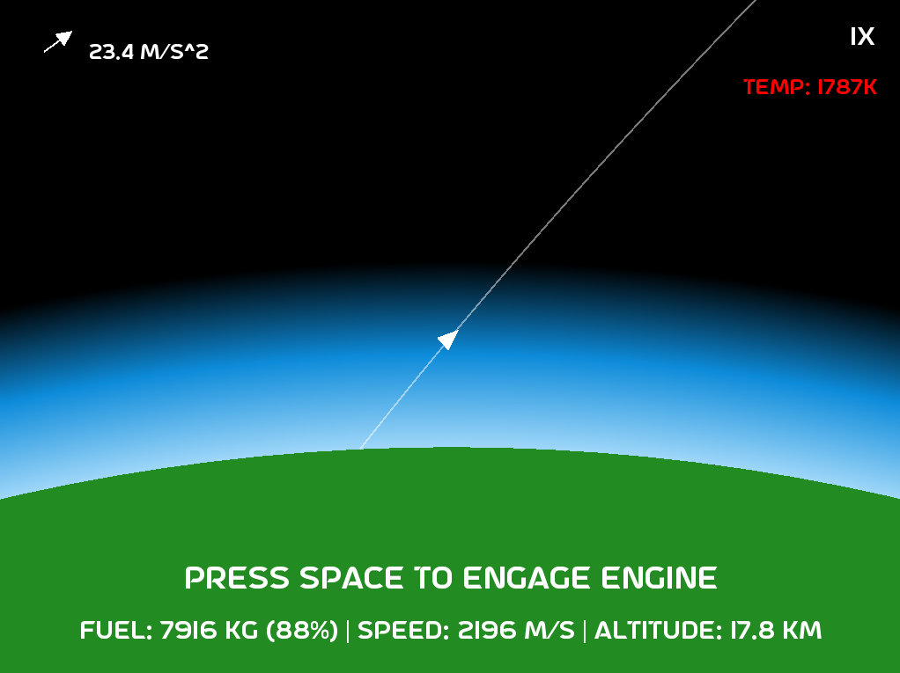

# Skypiercer

A 2D 3-body (Earth-Moon system) spaceflight simulator inspired by Spaceflight Simulator (SFS). Developed as a Python-based A-Level Computer Science NEA, this project implements a custom physics engine to simulate realistic orbital mechanics and the Apollo mission.

## Core Features

- **RK4 Physics Engine:** Utilises a Runge-Kutta 4th Order integration method to provide high stability and precision, preventing the "orbital drift" common in simpler Euler-based simulations.
- **Dual-Body System:** Realistic gravitational simulation involving both Earth and Moon, allowing for complex missions like lunar transits.
- **Hybrid Trajectory Projection:**
    - **Keplerian Patched Conics:** For stable elliptical orbits.
    - **Stepped Projection:** Real-time numerical integration for hyperbolic escape trajectories and Sphere of Influence (SoI) transitions.
- **Atmospheric Flight:** Includes models for atmospheric drag (fluid dynamics) and re-entry heating based on altitude and velocity.
- **Technical Flight Mechanics:** Implementation of Trans-Lunar Injection (TLI), Trans-Earth Injection (TEI), Thrust-to-Weight Ratio (TWR) calculations, and staging.
- **Cheat Interface:** Includes a cheat modal for directly altering constants and values to encourage experientation (e.g. setting rocket thrust to 99999999N)

## Development Methodology

The project followed a formal **Waterfall Methodology**, ensuring rigorous documentation and validation at every stage:

1.  **Analysis:** Problem decomposition, stakeholder consultation, and requirement specification.
2.  **Design:** Modular OOP architecture design, including Class Diagrams and algorithm pseudocode for the physics submodules.
3.  **Development:** Iterative coding in Python using the Pyglet library for high-performance 2D rendering.
4.  **Testing:** Comprehensive test plan covering unit testing of physics constants and integration testing of the flight HUD.
5.  **Evaluation:** Critical appraisal against the initial success criteria and stakeholder feedback.

## Project Structure

- `Rocket`: Manages state vectors, mass flow, and fuel consumption.
- `Bodies`: Defines celestial parameters (mass, radius, gravity) for Earth and the Moon.
- `Physics Engine`: The core loop handling force summation (Gravity + Thrust + Drag) and RK4 integration.
- `UI/Map`: A decoupled rendering system providing both a flight-focused HUD and a global Map View for trajectory planning.

## Controls

| Key        | Action                 |
| :--------- | :--------------------- |
| **ESC**    | Pause                  |
| **Space**  | Toggle Engine          |
| **Q / E**  | Throttle Control       |
| **Arrows** | Rotation               |
| **Enter**  | Stage Separation       |
| **P**      | Parachute              |
| **Scroll** | Zoom / Map/Flight View |
| **. / ,**  | Time Warp              |
| **C**      | Cheat Menu             |

## Screenshots

### Trajectory Projection

### TLI

### Moon Landing

### TEI

### Re-entry

### TLI Documentation

